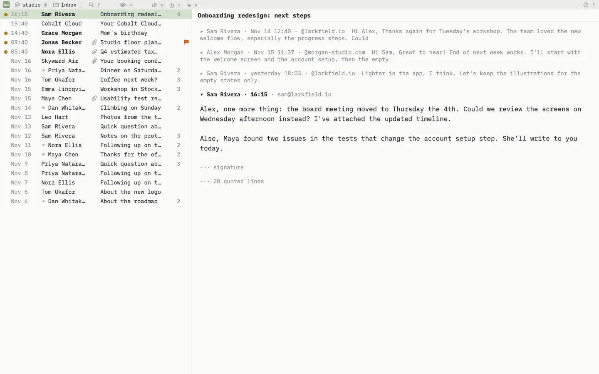
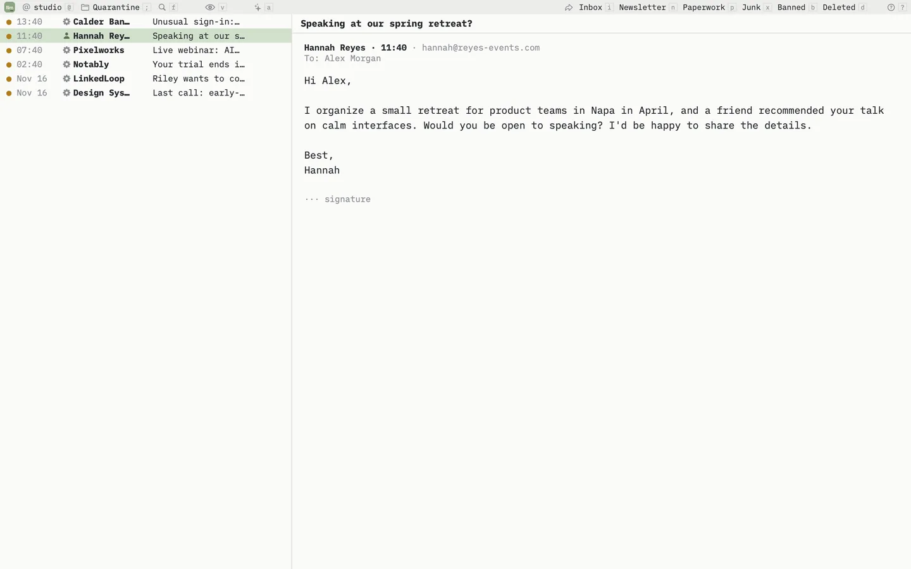
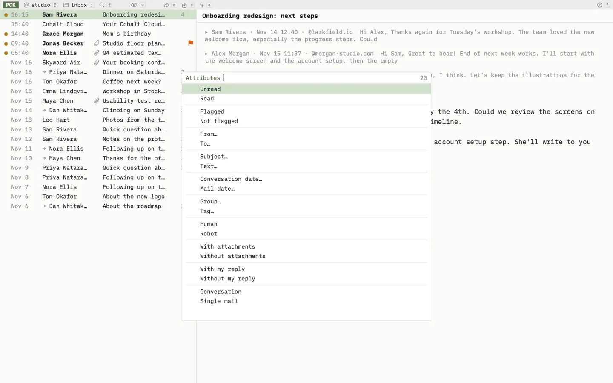
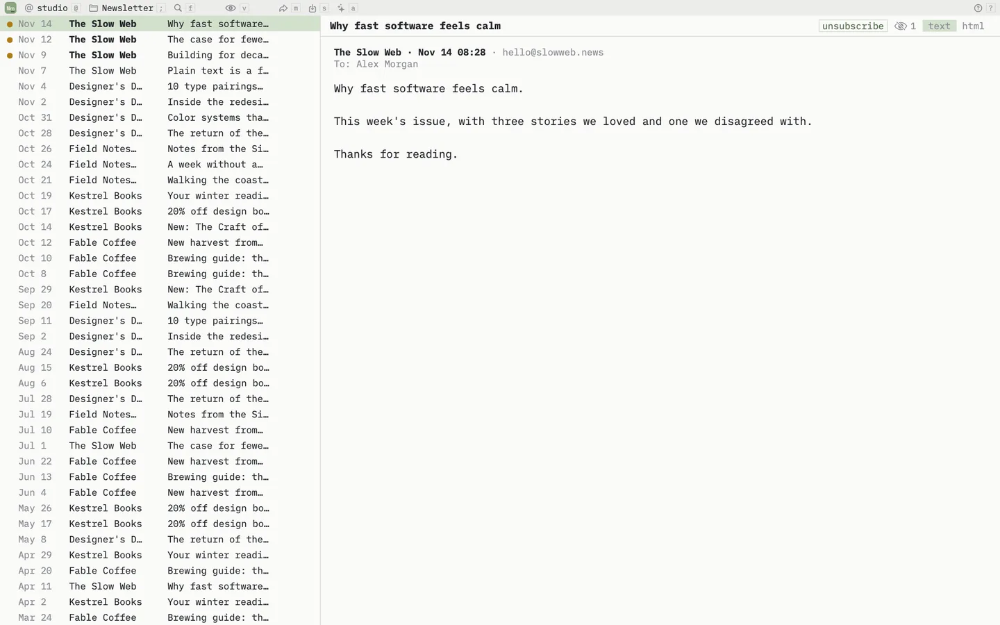

<div align="center">

# NiceMailer

**Fast to use. Calm to live with. Yours to keep.**

An email client for the Mac that stays instant with hundreds of thousands of emails,<br>
lets into your inbox only the people you chose, and keeps your mail on your Mac.

[](https://github.com/nicemailer/nicemailer/releases/latest)

[](LICENSE)

[Website](https://nicemailer.org) · [Download](https://github.com/nicemailer/nicemailer/releases/latest) · [Changelog](CHANGELOG.md) · [Documentation](docs/README.md)

<picture>
  <source media="(prefers-color-scheme: dark)" srcset="docs/images/inbox-dark.webp">
  
</picture>

</div>

## Why NiceMailer

- **Instant.** 2 ms to show a folder, even while new mail is downloading; 2 ms to show only the emails from real people among 400,000.
- **Driven by the keyboard.** Read, reply, file, tag and search with Vim-like keys, all of them configurable. The mouse works too.
- **Calm.** Unknown senders wait in Quarantine. You decide once per sender, and that decision files everything they sent and will send.
- **Yours.** Your mail lives in a local database on your Mac, every email has a permanent link to paste into Obsidian or Notion, and AI agents get only the access you grant.

<table>
  <tr>
    <td width="33%">
      <picture>
        <source media="(prefers-color-scheme: dark)" srcset="docs/images/quarantine-dark.webp">
        
      </picture>
      <p align="center"><sub>Quarantine: one key decides where a sender belongs</sub></p>
    </td>
    <td width="33%">
      <picture>
        <source media="(prefers-color-scheme: dark)" srcset="docs/images/filters-dark.webp">
        
      </picture>
      <p align="center"><sub>Filters that respond instantly, across every account</sub></p>
    </td>
    <td width="33%">
      <picture>
        <source media="(prefers-color-scheme: dark)" srcset="docs/images/thread-dark.webp">
        
      </picture>
      <p align="center"><sub>Conversations without quoted history or repeated signatures</sub></p>
    </td>
  </tr>
</table>

The full tour is on **[nicemailer.org](https://nicemailer.org)**.

## Install

[Download the latest release](https://github.com/nicemailer/nicemailer/releases/latest) (a signed and notarized disk image), and move NiceMailer to Applications. It needs macOS 14 or later on Apple Silicon, and updates itself.

Or with Homebrew: `brew install --cask nicemailer/tap/nicemailer` (from the [nicemailer/homebrew-tap](https://github.com/nicemailer/homebrew-tap) tap).

Coming from another client? See [Moving to NiceMailer](https://nicemailer.org/docs/moving-to-nicemailer/): an mbox export (HEY, Gmail, Thunderbird…) can be imported as an archive account ([docs/import-mbox.md](docs/import-mbox.md)).

## Under the hood

NiceMailer is a **Rust core** that owns the database and all the logic, and **clients** that talk to it over a Unix socket in JSON-RPC 2.0. The SwiftUI app is only one of them: the `nicemailer` command line and the MCP server for AI agents use the same contract ([docs/contract.md](docs/contract.md)).

```
crates/
  nm-core/     pure domain: folder roles and workflow rules, no I/O
  nm-store/    SQLite storage: schema, paginated queries, mutations, raw message files
  nm-engine/   configuration, accounts, secrets, synchronization
  nm-proto/    network: IMAP and SMTP clients, one-click unsubscribe
  nm-ai/       AI assistance: providers and prompts
  nm-api/      the contract: methods, views, events, error codes
  nm-daemon/   nicemailer-core, the JSON-RPC server
  nm-cli/      nicemailer, the command line
  nm-mcp/      nicemailer-mcp, the MCP server for AI agents
apps/
  NiceMailer/  the SwiftUI app
  editor/      the editor of a mail's text (TypeScript, in a web view)
```

### Scriptable

```sh
nicemailer folders
nicemailer call search '{"query": "invoice"}'
nicemailer watch            # live event stream
```

AI agents (Claude Desktop, Claude Code, any MCP client) can read the mailbox and prepare drafts through `nicemailer-mcp`; the core enforces what they may and may not do ([docs/mcp.md](docs/mcp.md)).

## Build from source

You need Rust, Xcode (the Command Line Tools alone do not ship the SwiftUI macros), and Node at the version in `apps/editor/.nvmrc` ([docs/editor.md](docs/editor.md)).

```sh
make seed     # a test mailbox of ≈ 4,500 fake mails
make core     # starts the core (leave it running)
make app      # in another terminal
make test     # Rust, Swift and editor tests
```

`make bundle` builds `NiceMailer.app` and installs it in `/Applications`, with its core run by a launch agent ([docs/app-bundle.md](docs/app-bundle.md)). `make bench` times every list on 100,000 generated conversations ([docs/testing.md](docs/testing.md)). `NICEMAILER_DATA_DIR=/other/directory` gives the core, the CLI and the app another data directory.

## Documentation

- [docs/](docs/README.md): every feature, for users and developers, in English.
- [specifications/](specifications/): the design specifications, in French.

Bugs and ideas go to the [issues](https://github.com/nicemailer/nicemailer/issues), questions and feedback to the [Discussions](https://github.com/nicemailer/nicemailer/discussions). To help, see [CONTRIBUTING.md](CONTRIBUTING.md).

## License

NiceMailer is free software under the [GNU Affero General Public License, version 3](LICENSE). Copyright (C) 2026 Achille Berès.

Bundled third-party code keeps its own licence:

- **iA Writer Mono V**, the font of the geek theme (SIL Open Font License), in `apps/NiceMailer/Sources/NiceMailer/Resources/Fonts`.
- **Dark Reader** 4.9.134 (MIT License), which adapts mails made for a white page to the dark theme, in `apps/NiceMailer/Sources/NiceMailer/Resources/DarkReader` ([docs/thread-display.md](docs/thread-display.md), "HTML of the sender").
